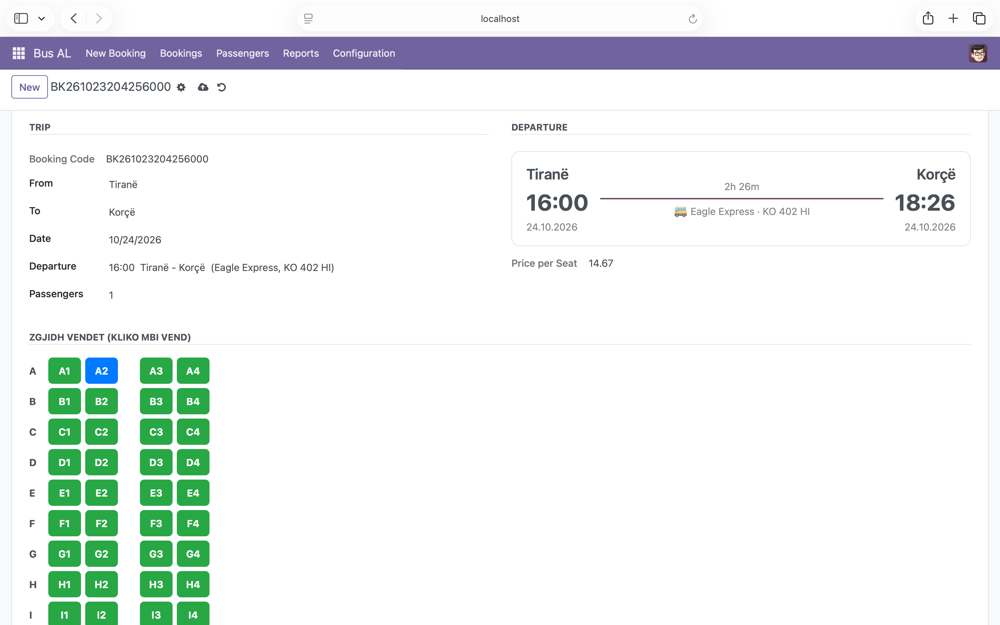
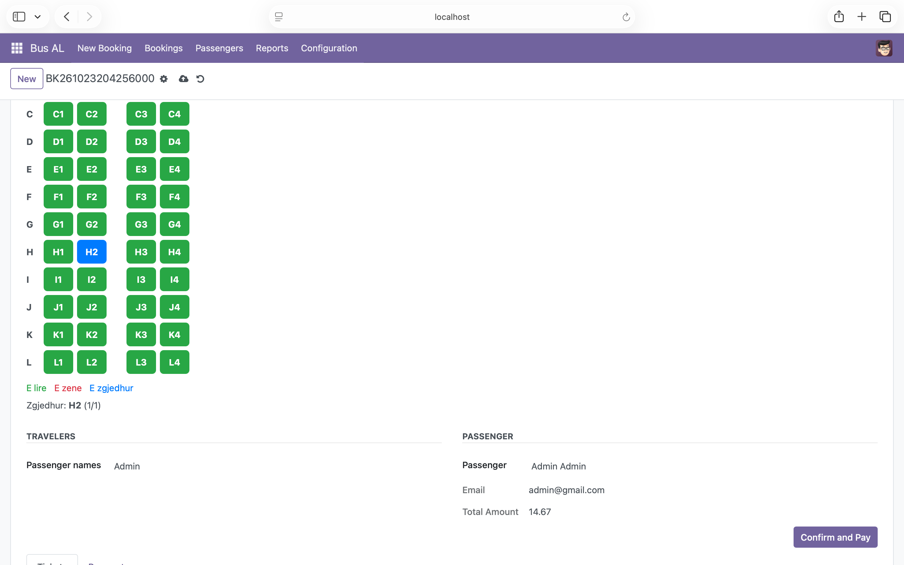
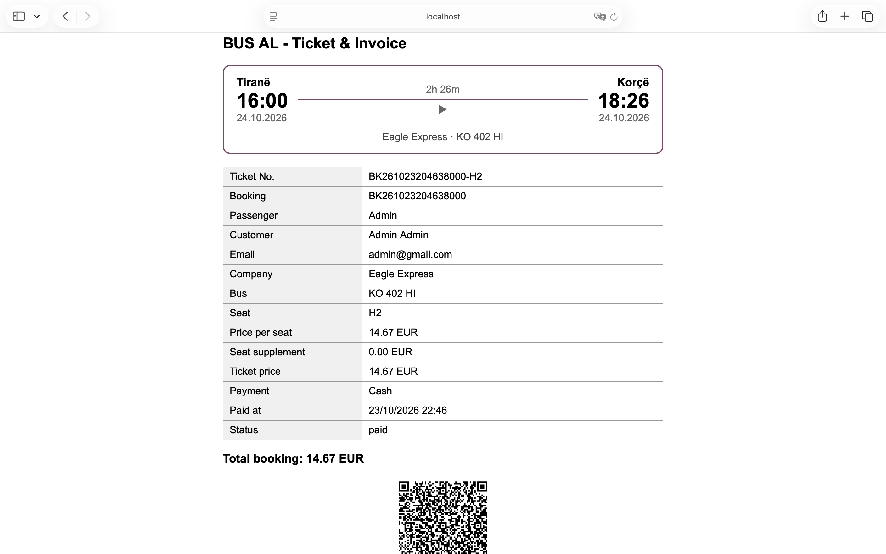

# BusAL

Platformë për rezervimin e biletave të autobusëve ndërqytetas, e ndërtuar si modul për Odoo 17.

## Funksionet
- Rezervim me zgjedhje të vendit në autobus
- Çmimi dhe koha e udhëtimit llogariten automatikisht nga distanca (0.10 €/km, orari me 60 km/h)
- Menaxhim i qyteteve, rrugëve, kompanive, autobusëve dhe orareve
- Faturë me kartë udhëtimi dhe QR kod
- Pagesa me totale për ditë, muaj dhe vit
- Vlerësime nga pasagjerët
- Role me të drejta të ndryshme aksesi

## Teknologjia
Odoo 17, Python, PostgreSQL, XML (views), JavaScript

## Instalimi
1. Kopjo folderin `busal` te `addons` i Odoo 17
2. Instalo varësinë: `pip install qrcode`
3. Rinis Odoo dhe instalo modulin BusAL nga Apps

## Autori
Marvi Ibrahimi

## Foto

